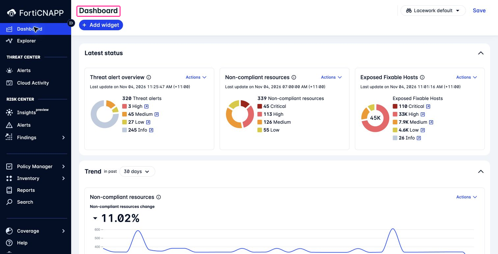

# Lab 1: What can FortiCNAPP tell you?

**Environment:** FORTIDEMO-2026-04. **Access:** Read-only.

## Concepts

Cloud security starts with knowing what is there: resources, workloads, identities, and the connections between them.
Then decide what needs attention. Suspicious activity needs investigation. Exposure and configuration problems need review.
Use the affected resources and possible impact to decide where to act first.

FortiCNAPP brings inventory, activity, and security findings together to support that work.
This lab shows where to find those views and which questions they help you answer.

## Objectives

- Find where to understand your environment, investigate activity, and review risk.
- Explain what context you need before choosing what to investigate or fix.

## Prerequisites

Use the console account supplied for the workshop.

## Lab steps

### Step 1: Confirm the tenant

Sign in to [the console](https://partner-demo.lacework.net/) with your workshop account.

1. Read the tenant name at the bottom of the navigation.
2. Open the tenant selector if another tenant is active.
3. Select **FORTIDEMO-2026-04**.
4. Open **Dashboard**.

**Checkpoint:** The tenant selector reads `FORTIDEMO-2026-04`.

### Step 2: Choose where to start

You have just opened the console. Is there activity to investigate, a configuration to fix, or an exposed host to patch?

1. Look at **Threat alert overview** for detected activity.
2. Compare it with **Non-compliant resources** for configuration problems.
3. Find **Exposed Fixable Hosts** for reachable hosts with available fixes.

**Checkpoint:** A teammate asks where to start with suspicious activity. Which widget would you choose?
Would you choose the same one to plan patching?

**Non-compliant resources** counts resources that fail an assessment. It does not count incidents.
The useful question is what each count helps you decide.

### Step 3: Find the view that answers your question

| Area | Use it to answer |
|---|---|
| Inventory and Coverage | What exists, and what data is being collected? |
| Threat Center | What activity needs investigation? |
| Risk Center | Which conditions need attention? |
| Explorer | How are these resources related? |
| Policy Manager | What query, policy, or framework defines this result? |
| Reports | What evidence should be delivered, and to whom? |

Use the table to locate the area you would open for an investigation.
Then open **Threat Center > Alerts** for the next lab.

**Checkpoint:** You can choose a starting view and explain what evidence you need from it.

## Discussion

You see a possible compromise on one host and many failed configuration checks.
Where would you start? What would you need to know about the resources, their exposure, and possible impact?

---
Next: [Lab 2: Composite alerts: is this host compromised?](../lab-02/README.md).
