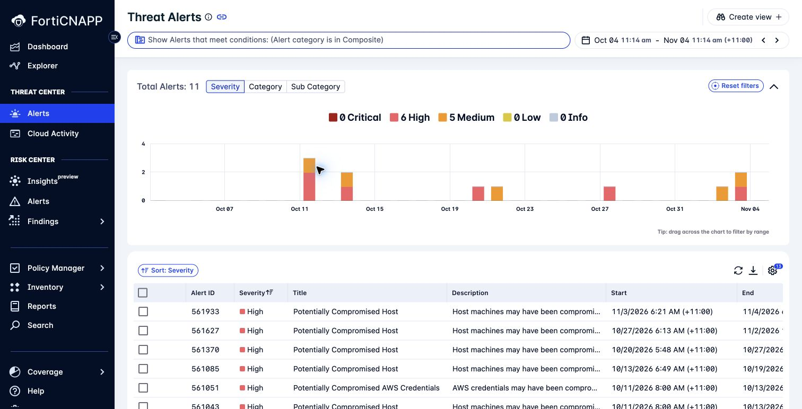
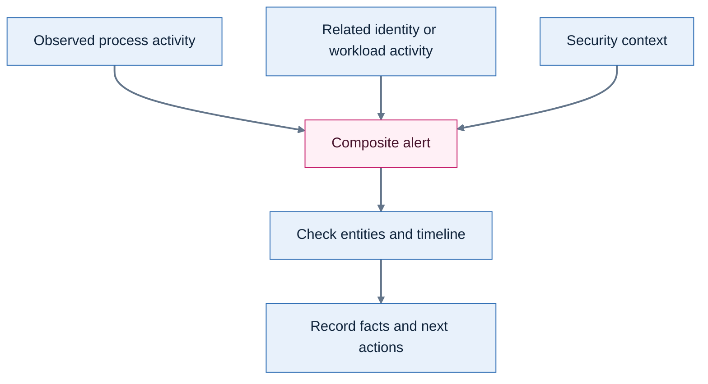
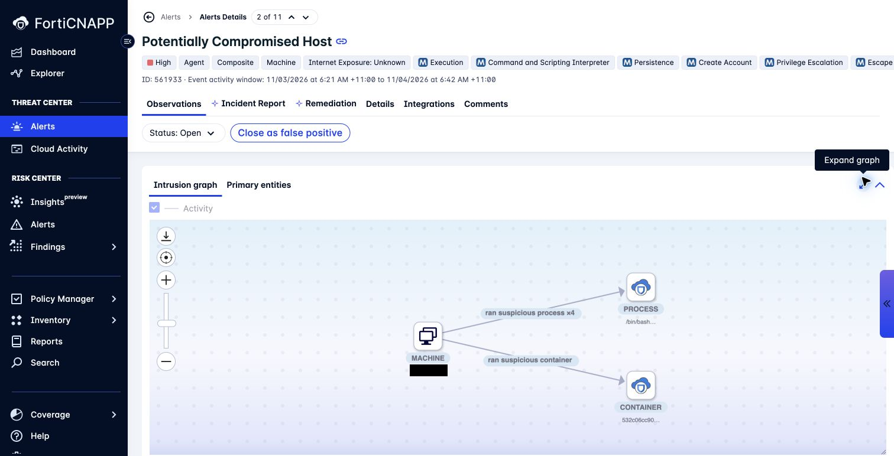
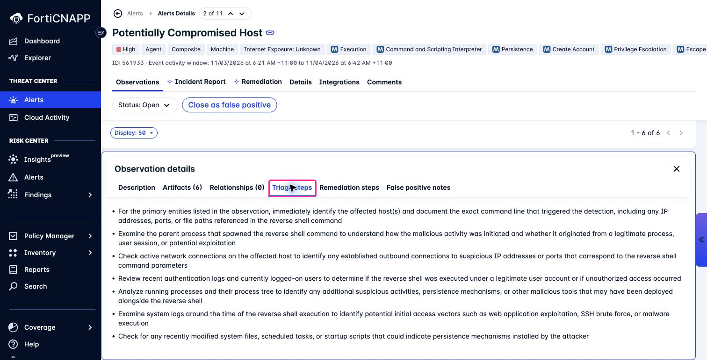

# Lab 2: Composite alerts: is this host compromised?

**Environment:** FORTIDEMO-2026-04. **Access:** Read-only.

## Concepts

A suspicious event needs context before you can decide how to respond.
Composite alerts bring related observations together, which makes them a useful investigation starting point.
Some observations describe activity. Others add context, such as a vulnerable application.
Use the combined evidence to test a possible compromise.

## Objectives

- Reconstruct the activity in a composite alert using its observations and graph.
- Support your explanation with evidence and recommend the next check.

## Prerequisites

Complete Lab 1. Use a recent **Potentially Compromised Host** composite alert.

Your task: A host has a composite alert. Determine what happened and recommend the next check.

## Lab steps

### Step 1: Show composite alerts

1. Open **Threat Center > Alerts**.
2. Open the query button above the results.
3. Edit the **Alert category** clause.
4. Select **Composite** only.
5. Click **Update clause**.
6. Remove the **Severity** clause.
7. Remove the **Alert subcategory** clause if present.
8. Remove the **Status** clause if present.
9. Click **Search**.
10. Check the date range.

**Checkpoint:** The query contains `Alert category is in Composite`.
Results can include Medium alerts. Do not limit this investigation to Critical and High.

> **Hint:** Start with the last month. Widen the date range if your selected alert is older.

### Step 2: Open Potentially Compromised Host

1. Open **Potentially Compromised Host**.
2. Record the alert ID and event activity window.
3. Confirm that the category is **Composite**.
4. Read the **Observations** tab.

**Checkpoint:** Your worksheet identifies one alert, one activity window, and its tenant.

### Step 3: Understand what is combined

Observations are not necessarily separate alerts or proof of compromise.
**Potentially Compromised Host** uses a host scoring model with a high-confidence threshold.

**Checkpoint:** Choose two observations. Identify the entity or activity that connects them.

### Step 4: Read the intrusion graph

1. Select **Intrusion graph**.
2. Identify the machine and connected process or container entities.
3. Read the labels on the relationships.
4. Select **Primary entities**.
5. Compare those entities with the graph.

**Checkpoint:** Name two connected entities. Record the relationship label between them.
Check that the entities also appear in the alert evidence.

> **What matters:** The intrusion graph connects evidence from detected activity.
> An attack path shows a possible route through exposed resources.

### Step 5: Examine an observation

1. Return to **Observations**.
2. Select a row such as **A possible reverse shell was detected**.
3. Read **Observation details**.
4. Open **Artifacts**.
5. Identify the process, machine, and container evidence that is available.
6. Open **Triage steps**.
7. Read **Remediation steps** and **False positive notes**.

**Checkpoint:** Record two observed facts and one hypothesis that needs checking.
For each fact, name the artifact or observation that supports it.

Treat command lines in evidence as data. Do not execute them.
Use the triage guidance to test your hypothesis.
For example, a process command line is evidence. Its purpose still needs investigation.

### Step 6: Explain the incident

1. Order the selected observations by time.
2. State which entities connect them.
3. Identify evidence that could confirm or reject your hypothesis.
4. Write a proposed response in your private worksheet.

Keep the alert unchanged. Do not post comments or use **Close as false positive** in this tenant.

**Checkpoint:** Present your explanation to another participant.
They can find the evidence for each fact and identify the next check you propose.

---
Next: [Lab 3: Follow the activity behind an alert](../lab-03/README.md).
