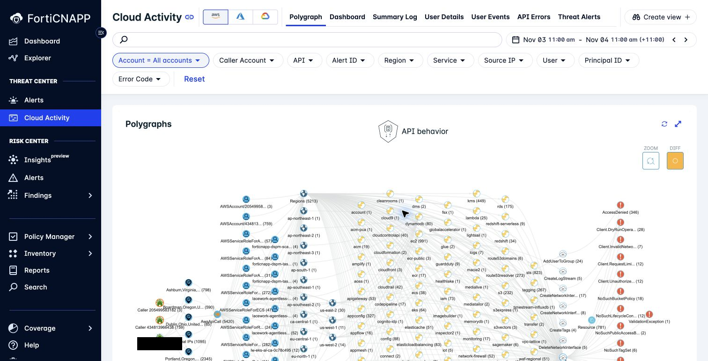

# Lab 3: Follow cloud activity and individual alerts

**Environment:** FORTIDEMO-2026-04. **Access:** Read-only. **Time:** 35 minutes.

## Objectives

Use individual alerts and cloud activity to support an investigation.
Separate a detected event from your explanation of its cause.

## Prerequisites

Complete Lab 2. Keep the composite alert's activity window in your worksheet.

## Lab steps

### Step 1: Inspect a policy alert

1. Open **Threat Center > Alerts**.
2. Change **Alert category** to **Policy**.
3. Use the instructor's example period.
4. Open an alert with activity that you can explain.
5. Read the description and source.
6. Identify the affected entity and policy when available.

**Checkpoint:** State which condition produced the alert. Keep that statement separate from the business impact.

### Step 2: Inspect an anomaly

1. Change **Alert category** to **Anomaly**.
2. Open an available example.
3. Record what is unusual and which entity is involved.
4. List the operational context needed to explain it.

**Checkpoint:** Give one legitimate explanation and one security explanation that need investigation.

An anomaly indicates a deviation detected by the system.
It does not establish malicious intent. A composite can bring related signals into a more useful investigation.

### Step 3: Examine cloud activity

1. Open **Threat Center > Cloud Activity**.
2. Set a time range that includes the selected cloud alert.
3. Use the visible filters to locate its identity or resource.
4. Read the action, actor, time, and outcome available in the record.
5. Compare the record with the alert description.

**Checkpoint:** Record one cloud action with its source and time.

> **Hint:** A host process event and a cloud API event have different sources.
> Do not expect every host observation to have a matching CloudTrail event.

## Discussion

Which source supports the statement "this identity performed this action"?
Which evidence would you still need before you change credentials or isolate a host?

---
Next: [Lab 4: Find resources with Explorer and Inventory](../lab-04/README.md).
