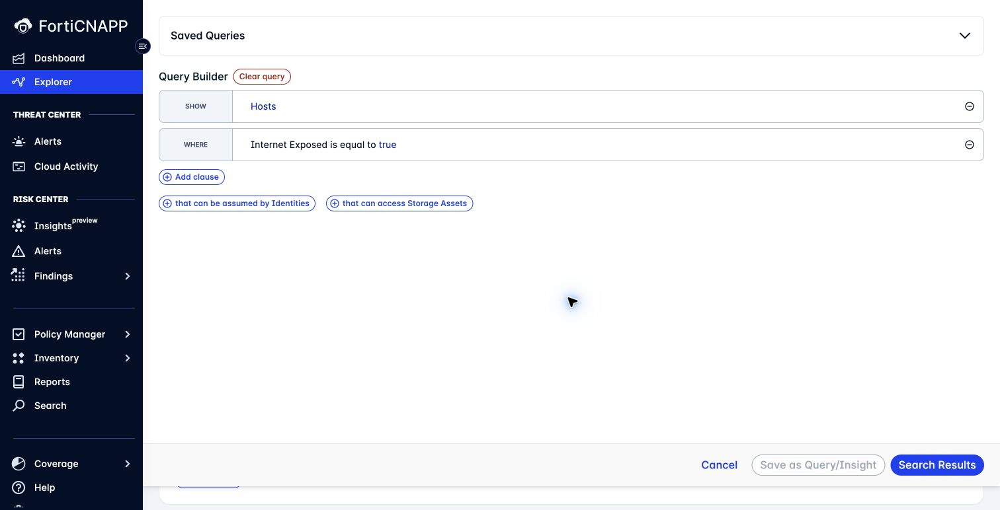

# Lab 4: Find the resources behind the alert

**Environment:** FORTIDEMO-2026-04. **Access:** Read-only.

## Concepts

An alert names an affected entity. You also need to understand where that entity sits in your environment.
Explorer shows resource relationships. Inventory shows resource properties and collected workload data.
Together, these views help you connect incident evidence to the resources and exposure that need attention.

## Objectives

- Trace an exposure route to a host in Explorer.
- Connect an alert entity to resource details and workload evidence where available.

## Prerequisites

Complete Lab 2. Keep one affected entity in your worksheet.
Use it to check whether an exposed resource is also part of your incident.

## Lab steps

### Step 1: Build an Explorer query

1. Open **Explorer**.
2. Select **Or use the Query Builder** if the plain-language search page opens.
3. Open the query button beside the search bar if the builder is closed.
4. Select **Hosts** as the return type.
5. Add **Internet Exposed** as a clause.
6. Set its value to **True**.
7. Apply the clause.
8. Click **Search Results**.

**Checkpoint:** The query contains **Hosts** and **Internet Exposed = True**.
If no hosts match, check the scope and data collection before changing the query.

### Step 2: Read a graph

1. Look for the host from your composite investigation in the results.
2. Select it if present. Otherwise, select a host with alerts or attack paths.
3. Open **Graph**.
4. Follow the resource relationships that permit exposure.
5. Record whether this is your incident host or a separate exposure example.

**Checkpoint:** List the resources along one exposure route in graph order.
Use the relationship labels to check each connection.

### Step 3: Compare inventory views

1. Open **Inventory > Resource Inventory**.
2. Locate an AWS or Azure resource.
3. Examine the resource properties and related findings.
4. Open **Inventory > Hosts**.
5. Examine the **Machines** and **Processes** views.

**Checkpoint:** Record one resource property from **Resource Inventory** and one process from **Hosts**.
Label their sources as cloud configuration and workload telemetry.

> **What matters:** A resource in cloud inventory does not prove that a workload agent is installed.
> Check **Coverage > Agents** when the investigation needs agent telemetry.

---
Next: [Lab 5: Where could an attacker go next?](../lab-05/README.md).
