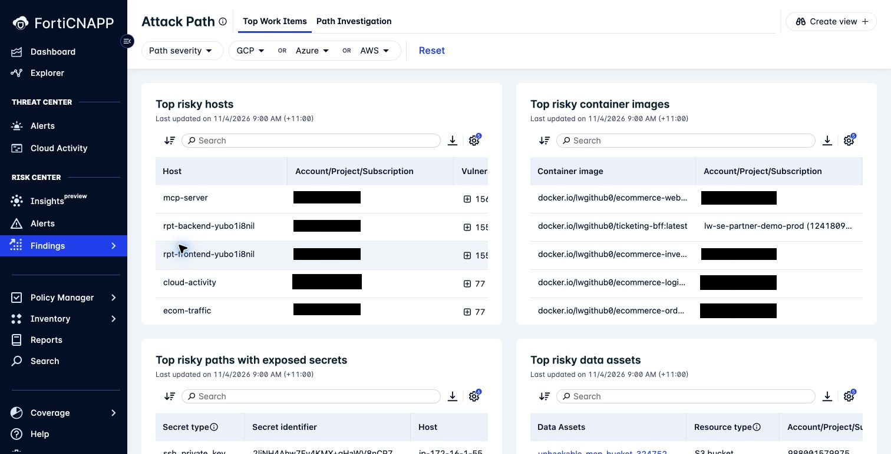
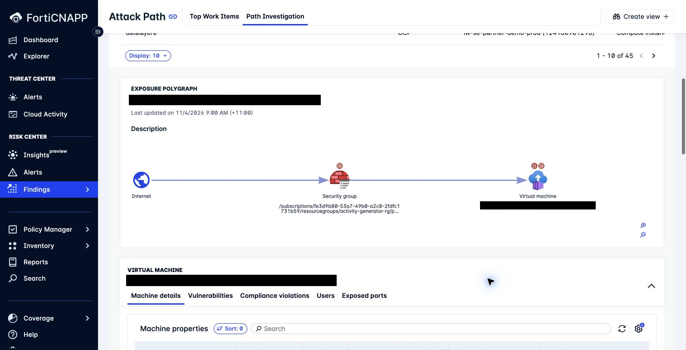
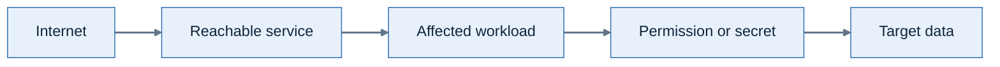

# Lab 5: Investigate risk and attack paths

**Environment:** FORTIDEMO-2026-04. **Access:** Read-only.

## Objectives

Identify conditions that permit exposure. Select a practical way to interrupt an attack path.
Keep exposure analysis separate from evidence of exploitation.

## Concepts

An attack path connects exposure conditions that could let an attacker reach a target.
It shows a possible route, not proof of exploitation.
Find a relationship that you can change to interrupt the route.

## Prerequisites

Complete Lab 4. Keep your incident host and any separate exposure example in your worksheet.
Your task is to propose one change that would interrupt an exposure path.

## Lab steps

### Step 1: Compare the two alert views

1. Open **Risk Center > Alerts**.
2. Open an available risk alert.
3. Identify the resource and condition.
4. Compare its question with the composite alert from Lab 2.

**Checkpoint:** Record the activity described by your threat alert and the condition described by your risk alert.

### Step 2: Find the top work items

1. Open **Risk Center > Findings > Attack Path**.
2. Select **Top Work Items**.
3. Examine **Top risky hosts**.
4. Examine **Top risky paths with exposed secrets**.
5. Identify the resource that you would investigate first.

**Checkpoint:** Name your first work item. Cite one exposure condition and one possible impact from its details.

### Step 3: Trace an exposure path

1. Select **Path Investigation**.
2. Look for a path involving your incident host. If none appears, select an AWS or Azure exposure example.
3. Scroll to the **EXPOSURE POLYGRAPH**.
4. Trace the relationships from the entry point to the target.
5. Inspect the available resource details, vulnerabilities, or compliance violations.

**Checkpoint:** Name an entry point, a target, and one relationship that permits the path.

Example exposure path.

### Step 4: Propose a path interruption

1. Select one relationship that you could change.
2. Explain how that change removes or reduces exposure.
3. Identify the service owner who must assess the operational effect.
4. Record how you would verify the change.

**Checkpoint:** Name the relationship to change, the exposure it removes, and the service check needed before the change.

Do not change cloud resources during this lab.

---
Next: [Lab 6: Examine identity and vulnerability context](../lab-06/README.md).
