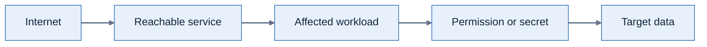

# Lab 5: Where could an attacker go next?

**Environment:** FORTIDEMO-2026-04. **Access:** Read-only.

## Concepts

A reachable service can be the start of a larger exposure problem.
An attack path connects conditions that could let an attacker reach a target.
It shows a possible route, not proof of exploitation.
Finding a relationship you can change gives you a practical way to interrupt that route.

## Objectives

- Trace an attack path from its entry point to its target.
- Propose a change that interrupts the path and identify the operational check it needs.

## Prerequisites

Complete Lab 4. Keep your incident host and any separate exposure example in your worksheet.
Your task is to propose one change that would interrupt an exposure path.

## Lab steps

### Step 1: Is this activity or an exposure condition?

1. Open **Risk Center > Alerts**.
2. Open an available risk alert.
3. Identify the resource and condition.
4. Compare its question with the composite alert from Lab 2.

**Checkpoint:** Which alert helps explain what happened? Which helps explain what could happen?
Use the condition or activity in each description to decide.

### Step 2: Choose your first work item

1. Open **Risk Center > Findings > Attack Path**.
2. Select **Top Work Items**.
3. Examine **Top risky hosts**.
4. Examine **Top risky paths with exposed secrets**.
5. Identify the resource that you would investigate first.

**Checkpoint:** If you could investigate only one item next, which would you choose?
Use its exposure and possible impact to justify the choice.

### Step 3: Follow the path to the target

1. Select **Path Investigation**.
2. Look for a path involving your incident host. If none appears, select an AWS or Azure exposure example.
3. Scroll to the **EXPOSURE POLYGRAPH**.
4. Trace the relationships from the entry point to the target.
5. Inspect the available resource details, vulnerabilities, or compliance violations.

**Checkpoint:** Follow the route as an attacker could use it.
Where could they enter, what could they reach, and which relationship permits the next step?

Example exposure path.

### Step 4: Propose a way to break the path

1. Select one relationship that you could change.
2. Explain how that change removes or reduces exposure.
3. Identify the service owner who must assess the operational effect.
4. Record how you would verify the change.

**Checkpoint:** Would your proposed change interrupt the path?
Show the relationship it removes and explain what the service owner must check before making it.

Do not change cloud resources during this lab.

---
Next: [Lab 6: Decide what to fix first](../lab-06/README.md).
