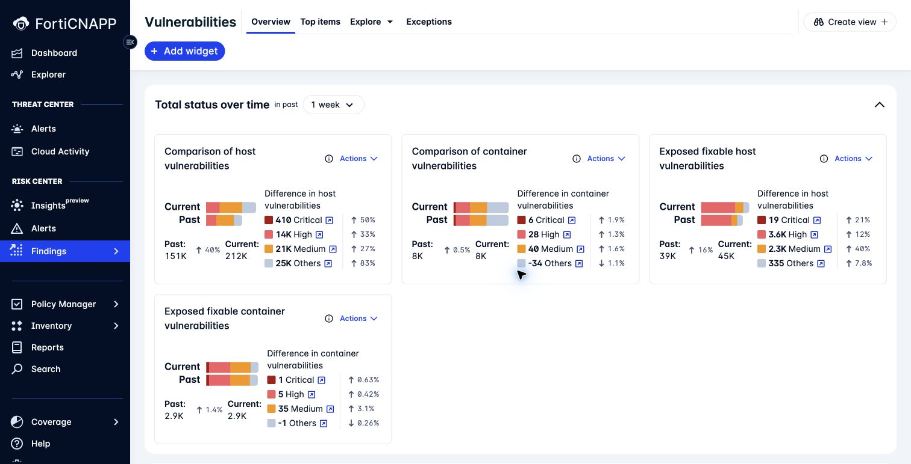

# Lab 6: Examine identity and vulnerability context

**Environment:** FORTIDEMO-2026-04. **Access:** Read-only. **Time:** 30 minutes.

## Objectives

Use identity and vulnerability context to improve a remediation decision.
Compare a package finding with the exposure of its affected resource.

## Prerequisites

Complete Lab 5. Keep one attack path resource in your worksheet.

## Lab steps

### Step 1: Examine an identity

1. Open **Risk Center > Findings > Identities**.
2. Open **Top Identity Risks**.
3. Select an identity.
4. Read its risks and available usage information.
5. Compare its permissions with the work it needs to perform.

**Checkpoint:** Propose a permission review with a named reason.

> **What matters:** An old or unused identity still needs an owner check.
> Usage history alone does not prove that removing access is safe.

### Step 2: Examine a vulnerability

1. Open **Risk Center > Findings > Vulnerabilities**.
2. Open **Top items**.
3. Compare **Top vulnerabilities by impacted hosts** with **Top fixable packages**.
4. Open one finding.
5. Identify the affected package and available fix information.
6. Check the host or image context.

The screenshot shows the Overview tab. Use Top items for the package comparison in this exercise.

**Checkpoint:** Explain why you would prioritise this package or resource.
Include exposure and available remediation in your answer.

### Step 3: Find the earlier control point

1. Open **Findings > Code Security > Infrastructure (IaC)**.
2. Examine an available assessment.
3. Open **Applications**.
4. Compare a dependency finding with a runtime vulnerability finding.

**Checkpoint:** Identify which evidence concerns source code and which evidence concerns a running workload.

This is an orientation exercise. The separate AWS workshop contains code scanning labs.

---
Next: [Lab 7: Interpret AWS and Azure CIS findings](../lab-07/README.md).
