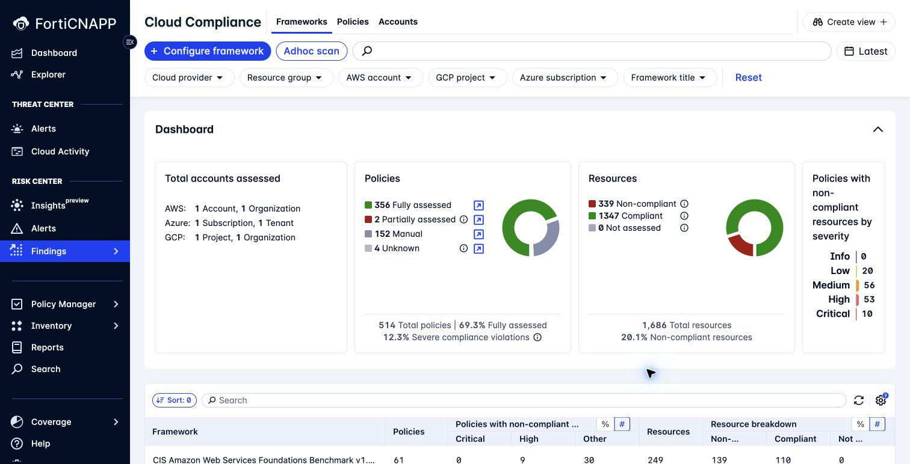
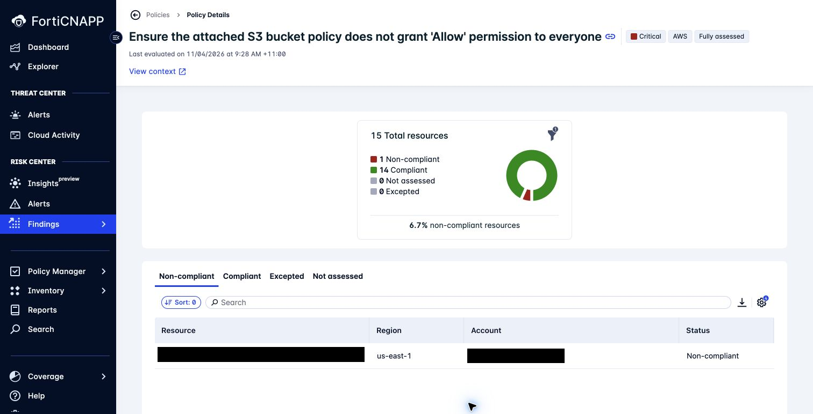

# Lab 7: Interpret AWS and Azure CIS findings

**Environment:** FORTIDEMO-2026-04. Use the sandpit for an unavailable Azure example. **Access:** Read-only.

## Objectives

Read a CIS assessment with the correct provider, version, scope, and collection time.
Trace a failed policy to its affected resources.

## Concepts

A CIS benchmark groups security controls for a specific cloud provider and version.
FortiCNAPP assesses supported controls against collected resource data.
Review failures and assessment gaps together to understand what the result covers.

## Prerequisites

Complete Lab 1.

## Lab steps

### Step 1: Read a framework result

Use the AWS and Azure scopes assigned for this lab.

1. Open **Risk Center > Findings > Compliance > Cloud**.
2. Select **Frameworks**.
3. Find an AWS CIS framework.
4. Record its complete title and version.
5. Inspect its assessed resources and policy breakdown.
6. Repeat for an Azure CIS framework that is available.

**Checkpoint:** Your worksheet has one AWS row and one Azure row.
Each row includes the framework title, version, scope, and assessment time.
If the demo tenant has no Azure result in the selected scope, use the sandpit for that comparison.

### Step 2: Find a failed policy

1. Select **Policies**.
2. Search for `permission to everyone`.
3. Open **Ensure the attached S3 bucket policy does not grant 'Allow' permission to everyone**.
4. Identify a non-compliant resource.
5. Compare **Non-compliant**, **Compliant**, **Excepted**, and **Not assessed**.

**Checkpoint:** Record the failed resource and the policy condition.
Use the resource assessment details to check that they match.

### Step 3: Interpret assessment coverage

1. Return to **Frameworks**.
2. Review fully assessed, partially assessed, manual, or unknown policy results that are present.
3. Record one assessment limitation.
4. Explain what evidence a manual control would need.

**Checkpoint:** Record one failed control and one assessment gap.
State whether each needs remediation or more evidence.

> **What matters:** A passing automated assessment does not establish complete CIS certification.
> Check manual controls, exclusions, coverage, and the exact framework version.

Use the existing assessments for this exercise.

---
Next: [Lab 8: Understand policy types and tuning controls](../lab-08/README.md).
