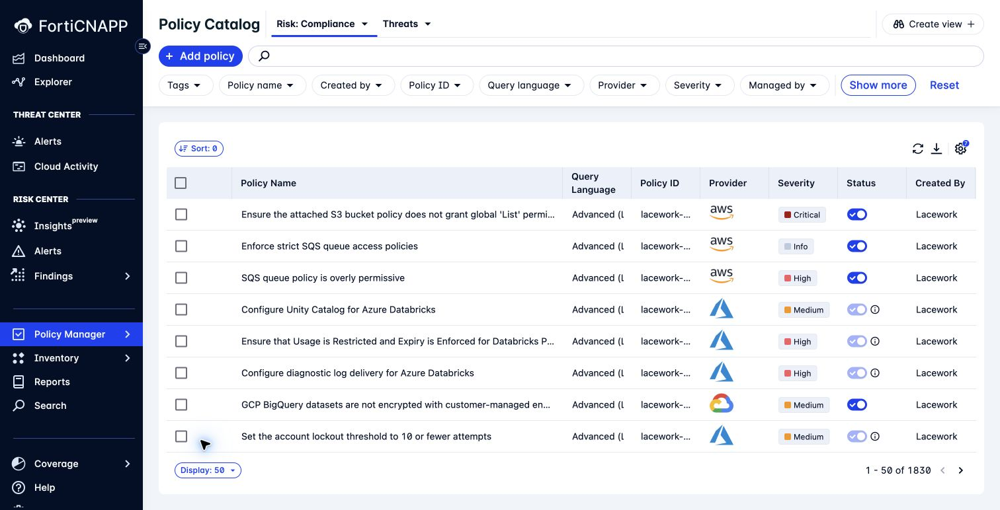
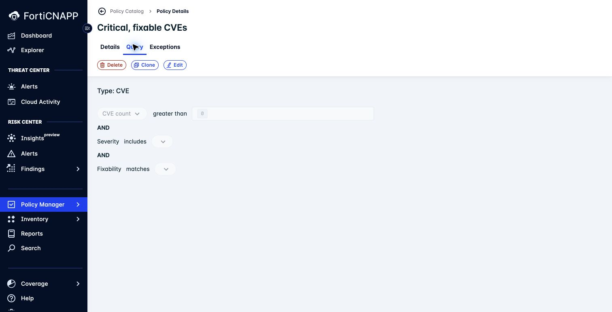
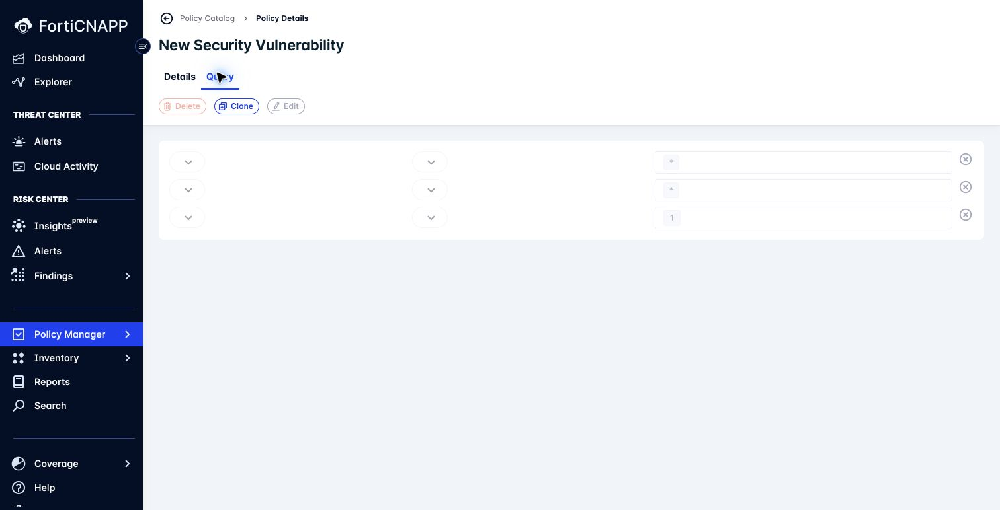
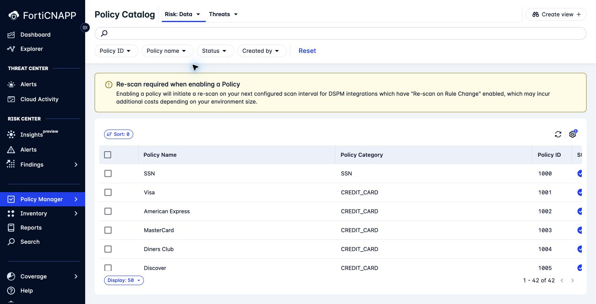
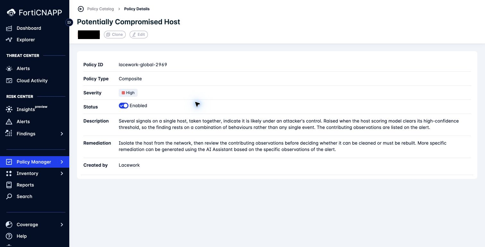
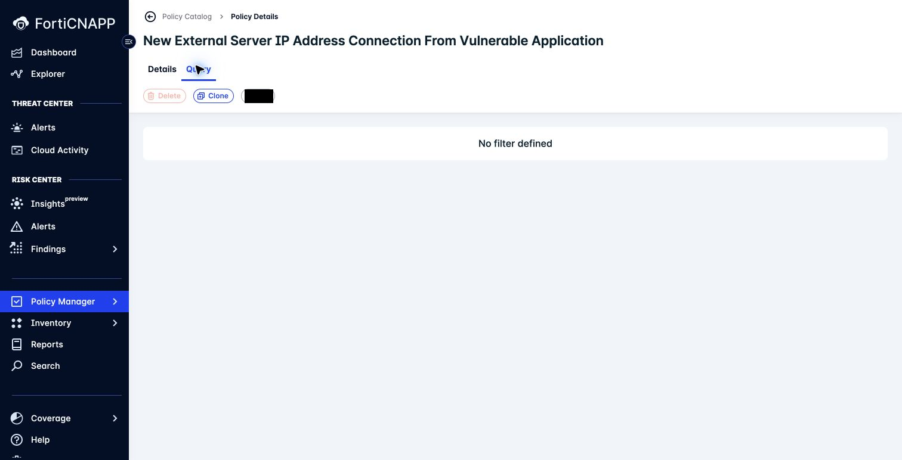
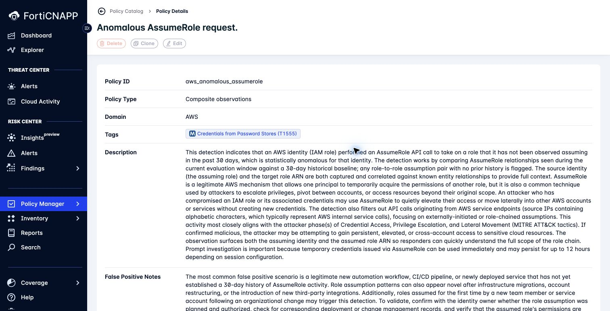
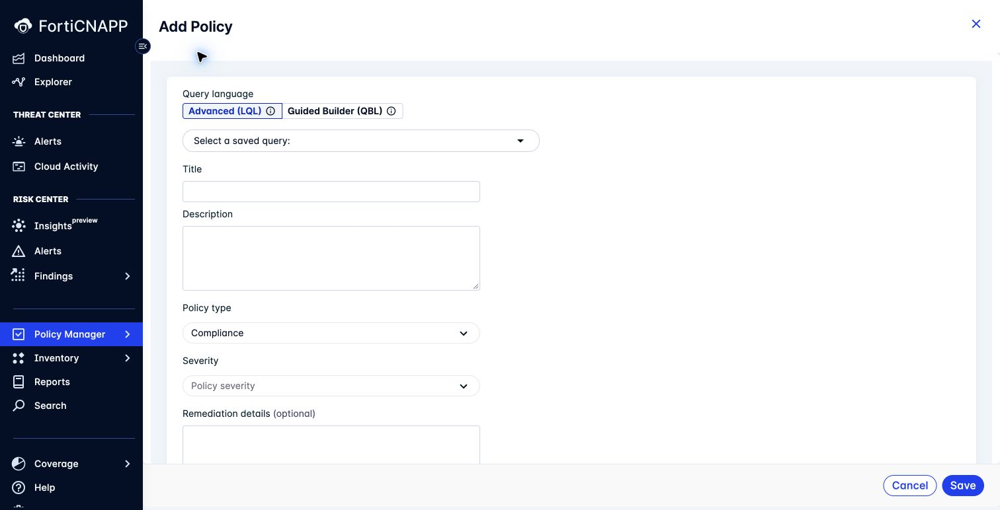

# Lab 8: Understand policy types and tuning controls

**Environment:** FORTINETAPACDEMO. **Access:** Read-only review.

## Objectives

Find every category in Policy Manager. Identify which controls apply to each category.
Prepare a tuning decision before making a change.

## Concepts

Policy categories evaluate different evidence and expose different tuning controls.
A compliance query tests resource configuration. A composite policy combines observations for investigation.
Review the category and available controls before choosing a change.

## Prerequisites

Complete Labs 2 and 7.
Screenshots use the demo tenant. Review sandpit policies without changing them.

## Lab steps

### Step 1: Map the catalog

1. Confirm **FORTINETAPACDEMO**.
2. Open **Policy Manager > Policies**.
3. Open the **Risk** selector.
4. Locate **Compliance**, **Vuln Build time**, **Vuln Run time**, and **Data** if available.
5. Open the **Threats** selector.
6. Locate **Anomalies**, **Threat Observations**, and **Composite Alerts**.

Use the policy review table in [your worksheet](../evidence-worksheet.md).
Record one example and its available controls for each category.
Mark categories unavailable to your role or tenant.

**Checkpoint:** Your table has a row for each of the seven categories.

### Step 2: Review a compliance policy

1. Open **Risk: Compliance**.
2. Select a policy that you examined in Lab 7.
3. Read its assessed condition, severity, and remediation.
4. Inspect the available editing controls without saving.

**Checkpoint:** Record the condition that the policy checks and one available tuning control.

### Step 3: Compare vulnerability policies

1. Open **Vuln Build time**.
2. Select **Critical, fixable CVEs**.
3. Read **Action on failure** and the container registry scope in **Details**.
4. Open **Query**.
5. Record the CVE count, severity, and fixability criteria.

6. Open **Vuln Run time**.
7. Select **New Security Vulnerability**.
8. Compare its **Details** and **Query** tabs with the build-time policy.
9. Record its **Frequency** and query conditions.

**Checkpoint:** Name one criterion from each policy. Identify whether **Clone** is available for each.

### Step 4: Review a Data policy

1. Open **Data** if available.
2. Select one policy.
3. Identify its data security condition and affected assets.
4. Record the available controls without changing them.

Enabling a Data policy can initiate a rescan for configured DSPM integrations.
Keep it unchanged during this review.

**Checkpoint:** Your Data row identifies an assessed condition or records that the category is unavailable.

### Step 5: Read a composite policy

1. Open the **Threats** selector.
2. Select **Composite Alerts**.
3. Open **Potentially Compromised Host**.
4. Read its description and contributing-observation model.
5. Inspect **Edit** and **Clone**.

The managed example has disabled Edit and Clone controls.

**Checkpoint:** Connect the policy description to one observation from your Lab 2 alert.
Record whether the editing controls are available in your tenant.

### Step 6: Review an anomaly policy

1. Open **Anomalies**.
2. Select **New External Server IP Address Connection From Vulnerable Application**.
3. Read its frequency, severity, domain, and type in **Details**.
4. Open **Query**.
5. Check whether **Clone** is available.

**Checkpoint:** Your row records **No filter defined** for this example and the state of **Clone**.

### Step 7: Read a threat observation definition

1. Open **Threat Observations**.
2. Select **Anomalous AssumeRole request.** if available. Otherwise, select another definition.
3. Read its description, false positive notes, and triage guidance.
4. Inspect **Edit** and **Clone** without changing the definition.

**Checkpoint:** Record one triage check and whether the definition can be edited or cloned.

### Step 8: Inspect custom policy choices

1. Return to **Risk: Compliance**.
2. Click **Add policy**.
3. Compare **Advanced (LQL)** with **Guided Builder (QBL)**.
4. Inspect **Policy type**.
5. Close the form without saving.

LQL is the query language used in the advanced editor. QBL uses the guided query builder.
The LQL path offers Compliance and Violation. The QBL path fixes the policy type to Compliance.
A new QBL policy creates a corresponding Risk Insight within about six hours.

**Checkpoint:** Record the policy types available for each authoring path.

### Step 9: Choose a tuning action

Choose one policy from your table. Propose a change using the questions below.

| Action | Question to answer first |
|---|---|
| Change severity | Does business impact justify a different priority? |
| Change query criteria | Which resources should match, and which should not? |
| Add an exception | What exact scope and expiry are justified? |
| Change alert routing | Which team needs this alert? |
| Disable a policy | What detection or assessment coverage would be lost? |

> **What matters:** Choose a control that addresses the problem. Changing severity changes priority; it does not change which resources match.

**Checkpoint:** Your proposal names an available control, its scope, and the expected result.
Include one check for evidence that the change could hide.
Keep existing policies unchanged. You will create your own policy in Lab 9.

---
Next: [Lab 9: Build and test a custom query and policy](../lab-09/README.md).
