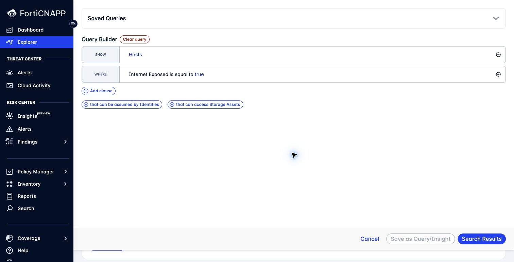
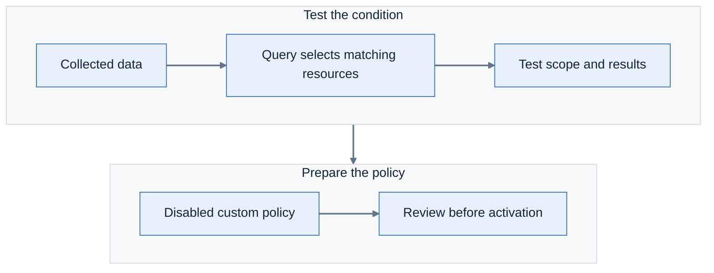

# Lab 9: Build and test a custom query and policy

**Environment:** FORTINETAPACDEMO. **Access:** Read/write.

## Objectives

Test the condition before you save a policy. Compare the QBL and LQL authoring paths.
Create an isolated policy that does not change existing detections.

## Concepts

A query selects data that matches a condition. A policy uses that query to define an assessment or detection.
Test the query first to check its scope and results.
A disabled policy lets you review the configuration before activation.

## Prerequisites

Complete Lab 8.
Screenshots show demo forms. Save objects only in the sandpit.

## Lab steps

### Step 1: Build a QBL query

1. Confirm **FORTINETAPACDEMO**.
2. Open **Policy Manager > Queries**.
3. Click **Add Query**.
4. Select **Add Explorer Query**.
5. Select **Hosts** as the return type.
6. Click **Add clause** to confirm the return type.
7. Add **Internet Exposed** with the value **True**.
8. Click **Search Results**.
9. Inspect one matching resource.



**Checkpoint:** Your query contains **Internet Exposed = True**.
Open one returned resource and identify the exposure relationship in its graph.
If the result is empty, inspect data coverage before concluding that no exposure exists.

### Step 2: Save the query

Choose a unique participant ID, such as `ab04`.
Replace `YOURID` in workshop names with this ID. For example: `Workshop-ab04-exposed-hosts`.
Record each saved object's name and ID under **Created objects** in [your worksheet](../evidence-worksheet.md).
Use the same participant ID in later labs.

1. Click **Save as Query/Insight**.
2. Set the name to `Workshop-YOURID-exposed-hosts`.
3. Record the generated **Query ID**.
4. Add a description of the intended result.
5. Click **Save Query Only**.
6. Find the query in **Policy Manager > Queries**.

**Checkpoint:** Your saved query has a unique name and recorded ID.
Saving a query does not by itself enable a detection policy.

### Step 3: Prepare the sandpit CLI profile

Install `lacework` and `jq` using the [CLI reference](https://docs.fortinet.com/document/forticnapp/latest/cli-reference).
Download this repository's files to your computer. Open a terminal in the repository folder.
Use the API key supplied for your sandpit account.

Run these commands:

```bash
lacework version
jq --version
```

Both commands must print a version. The examples use bash or zsh.
Replace the key file path with your private path:

```bash
lacework configure --profile fortinetapacdemo \
  --account partner-demo --subaccount fortinetapacdemo \
  --json_file /PRIVATE/PATH/sandpit-key.json --noninteractive

lacework configure show account --profile fortinetapacdemo
lacework configure show subaccount --profile fortinetapacdemo
```

**Checkpoint:** The account is `partner-demo`. The subaccount is `fortinetapacdemo`.

> [!CAUTION]
> Keep key files and CLI configuration private. Do not paste them into chat, tickets, or Git.

### Step 4: Test an LQL condition

Your task is to find EC2 instances that do not require IMDSv2 tokens.
Test the condition before saving a disabled policy.

The example finds EC2 configuration where `MetadataOptions.HttpTokens` is not `required`.
It checks one IMDSv2 setting, not a complete CIS control.

From the repository root, run:

```bash
set -o pipefail
lacework query run -f examples/ec2-imdsv2.json \
  --start -7d --end now --limit 5 \
  --profile fortinetapacdemo --account partner-demo \
  --subaccount fortinetapacdemo --json --noninteractive \
  | jq '{sampleRows:length,fields:((.[0] // {}) | keys)}'
```

**Checkpoint:** The command succeeds. The result reports sample rows and their field names.
The five-row limit gives a sample, not a tenant-wide count.

> **Hint:** The seven-day window can include older configuration snapshots.
> If the result is empty, compare the window with the resource collection time in Explorer.

### Step 5: Create a disabled LQL policy

1. Copy `examples/ec2-imdsv2.json` to a private working folder.
2. Replace `REPLACE_ID` in `queryId` with your participant ID.
3. Create the query. Replace `YOUR_QUERY_FILE` with your file path:

```bash
lacework query create -f YOUR_QUERY_FILE \
  --profile fortinetapacdemo --account partner-demo \
  --subaccount fortinetapacdemo --json --noninteractive
```

4. Record the returned query ID.
5. Prepare a policy file using this shape. Set `queryId` to the exact ID you recorded:

```yaml
title: Workshop-YOURID-IMDSv2
enabled: false
policyType: Violation
alertEnabled: false
queryId: Workshop_IMDSv2_YOURID
severity: high
description: Identify collected EC2 instances that do not require IMDSv2 tokens.
remediation: Review application requirements before requiring IMDSv2 tokens.
```

6. Create the policy. Replace `YOUR_POLICY_FILE` with your file path:

```bash
lacework policy create -f YOUR_POLICY_FILE \
  --profile fortinetapacdemo --account partner-demo \
  --subaccount fortinetapacdemo --json --noninteractive
```

7. Record the returned policy ID.
8. Find the policy in **Policy Manager > Policies**.
9. Confirm that it remains disabled.

**Checkpoint:** The saved policy references your query. `enabled` and `alertEnabled` are both false.



### Step 6: Review a tuning change

Open your own policy. Change its description or severity using the available editor.
Keep it disabled. Read the saved value back.

**Checkpoint:** Read the edited field back from your policy. It matches your change.
The policy remains disabled.

Do not enable the policy during this exercise. Activation requires a separate scope and routing review.
Remove both queries and the policy in Lab 16.

---
Next: [Lab 10: Build a custom compliance framework](../lab-10/README.md).
