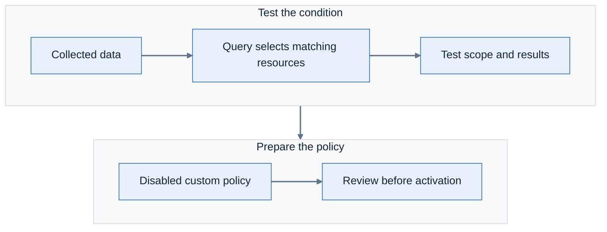

# Lab 9: Build and test a custom query and policy

**Environment:** FORTINETAPACDEMO. **Access:** Read/write.

## Objectives

Test the condition before you save a policy. Compare the QBL and LQL authoring paths.
Create an isolated policy that does not change existing detections.

## Prerequisites

Complete Lab 8. Use a unique participant ID.
For the LQL exercise, complete CLI setup from Lab 13 first.
Screenshots show demo forms. Save objects only in the sandpit.

## Lab steps

### Step 1: Build a QBL query

1. Confirm **FORTINETAPACDEMO**.
2. Open **Policy Manager > Queries**.
3. Click **Add Query**.
4. Select **Add Explorer Query**.
5. Select **Hosts** as the return type.
6. Click **Add clause** to confirm the return type.
7. Add **Internet Exposed** with the value **True**.
8. Click **Search Results**.
9. Inspect one matching resource.


**Checkpoint:** Explain why the returned resource matches.
If the result is empty, inspect data coverage before concluding that no exposure exists.

### Step 2: Save the query

1. Click **Save as Query/Insight**.
2. Set the name to `Workshop-YOURID-exposed-hosts`.
3. Record the generated **Query ID**.
4. Add a description of the intended result.
5. Click **Save Query Only**.
6. Find the query in **Policy Manager > Queries**.

**Checkpoint:** Your saved query has a unique name and recorded ID.
Saving a query does not by itself enable a detection policy.

### Step 3: Test an LQL condition

The example finds EC2 configuration where `MetadataOptions.HttpTokens` is not `required`.
It checks one IMDSv2 setting, not a complete CIS control.

From the repository root, run:

```bash
set -o pipefail
lacework query run -f examples/ec2-imdsv2.json \
  --start -7d --end now --limit 5 \
  --profile fortinetapacdemo --account partner-demo \
  --subaccount fortinetapacdemo --json --noninteractive \
  | jq '{sampleRows:length,fields:((.[0] // {}) | keys)}'
```

**Checkpoint:** The command succeeds. The result reports sample rows and their field names.
The five-row limit gives a sample, not a tenant-wide count.

> **Hint:** The seven-day window can include older configuration snapshots.
> If the result is empty, compare the window with the resource collection time in Explorer.

### Step 4: Create a disabled LQL policy

1. Copy `examples/ec2-imdsv2.json` to a private working folder.
2. Replace `REPLACE_ID` in `queryId` with your participant ID.
3. Create the query with `lacework query create -f YOUR_QUERY_FILE`.
4. Pass the sandpit profile, account, and subaccount flags from Step 3.
5. Prepare a policy file using this shape:

```yaml
title: Workshop-YOURID-IMDSv2
enabled: false
policyType: Violation
alertEnabled: false
queryId: Workshop_IMDSv2_YOURID
severity: high
description: Identify collected EC2 instances that do not require IMDSv2 tokens.
remediation: Review application requirements before requiring IMDSv2 tokens.
```

6. Create it with `lacework policy create -f YOUR_POLICY_FILE` and the same sandpit flags.
7. Record the returned policy ID.
8. Find the policy in **Policy Manager > Policies**.
9. Confirm that it remains disabled.

**Checkpoint:** The saved policy references your query. Both enabled fields are false.



### Step 5: Review a tuning change

Open your own policy. Change its description or severity using the available editor.
Keep it disabled. Read the saved value back.

**Checkpoint:** Only your policy changed. Record the previous and new values.

Do not enable the policy during this exercise. Activation requires a separate scope and routing review.
Remove both queries and the policy in Lab 16.

---
Next: [Lab 10: Build a custom compliance framework](../lab-10/README.md).
