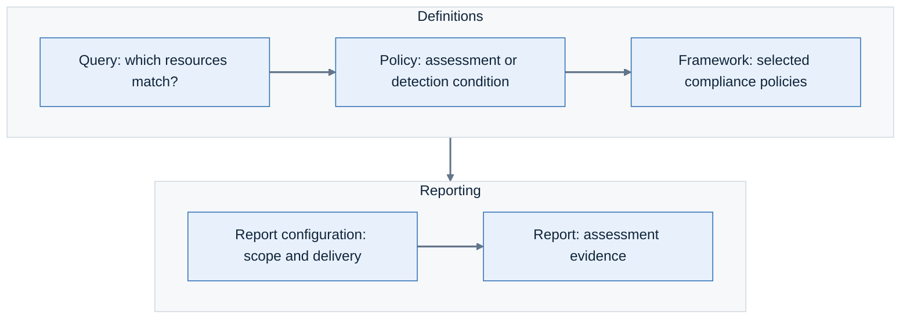

# Lab 10: Build a custom compliance framework

**Environment:** FORTINETAPACDEMO. **Access:** Read/write.

## Objectives

Group policies for a specific reporting purpose. Keep a custom framework distinct from the original CIS benchmark.

## Concepts

A framework groups compliance policies into sections for assessment and reporting.
A custom framework lets you select controls for a specific review.
If you change a CIS framework's policy selection, the result is a custom control set.

## Prerequisites

Complete Lab 7. Use your participant ID.
Use the AWS CIS framework that you examined in Lab 7.
Screenshots show the demo tenant. Save only in the sandpit.

## Lab steps

### Step 1: Inspect the framework catalog

1. Confirm **FORTINETAPACDEMO**.
2. Open **Policy Manager > Frameworks**.
3. Compare **Lacework managed** with **Managed by you**.
4. Open a built-in framework.
5. Inspect its sections and policy mappings.

**Checkpoint:** Name one section and a policy mapped to it.
The policy defines the check. The framework groups that check with others.

Compliance reporting workflow.

### Step 2: Create a custom framework

1. Return to the catalog.
2. Click **Add Framework**.
3. Select the AWS CIS framework from Lab 7.
4. Continue to the framework editor.
5. Set a unique name: `Workshop-YOURID-AWS-review`.
6. Select **Networking** in the copied framework.
7. Click **Add / Edit policies**.
8. Select **Selected policies**.
9. Choose one policy to omit from your custom review.
10. Record why it is outside your review scope.
11. Clear that policy.
12. Click **Update section**.
13. Save your custom framework.

**Checkpoint:** Your framework appears under **Managed by you**.
Reopen its edited section. The omitted policy is absent. The source framework is unchanged.

> **What matters:** A modified CIS-based framework is a custom control set.
> Do not present it as the complete, unchanged CIS benchmark.

### Step 3: Review revision and evaluation state

1. Reopen your framework.
2. Record its revision and policy selection.
3. Check for **Pending changes**.
4. Explain which assessment results may still reflect the earlier configuration.

**Checkpoint:** Your worksheet records the framework name, provider, revision, and reporting purpose.

Framework changes can take up to 24 hours to appear in assessment results.
Continue with the existing assessment while the changes are evaluated.
Keep this framework for cleanup. Lab 11 uses the built-in CIS frameworks for its main reports.

---
Next: [Lab 11: Configure AWS and Azure CIS reports](../lab-11/README.md).
