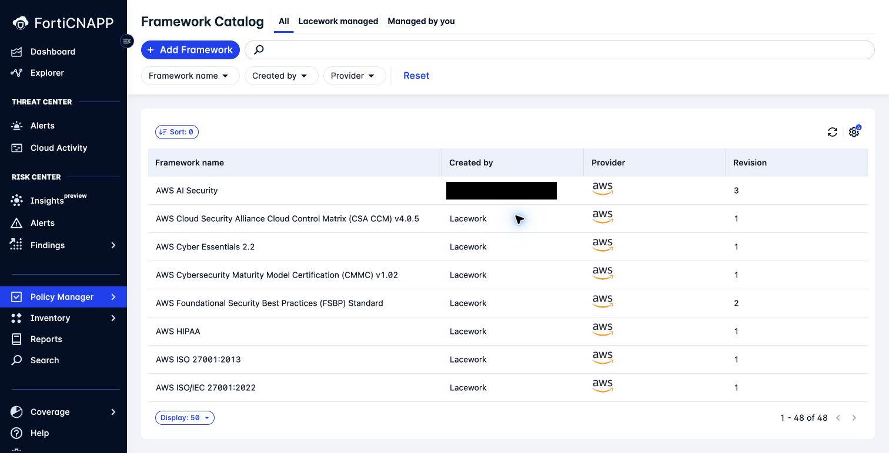
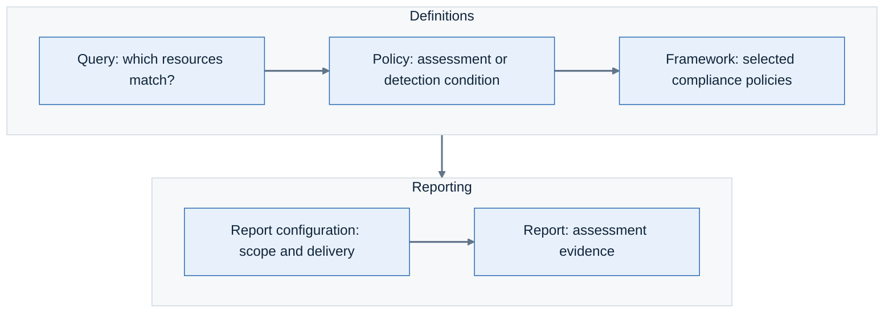

# Lab 10: Build a compliance framework for your review

**Environment:** FORTINETAPACDEMO. **Access:** Read/write.

## Concepts

A specific review can need a different selection of controls from a complete benchmark.
A framework groups compliance policies into sections for assessment and reporting.
A custom framework lets you choose that selection.
If you change a CIS framework, present the result as a custom control set.

## Objectives

- Create a custom framework with a policy selection that matches your review purpose.
- Verify the saved selection and recognise results that still await evaluation.

## Prerequisites

Complete Lab 7.
Use the AWS CIS framework that you examined in Lab 7.
Screenshots show the demo tenant. Save only in the sandpit.

## Lab steps

### Step 1: Find how controls fit together

Your review needs a selected set of controls. Find how a framework organises them before you change the selection.

1. Confirm **FORTINETAPACDEMO**.
2. Open **Policy Manager > Frameworks**.
3. Compare **Lacework managed** with **Managed by you**.
4. Open a built-in framework.
5. Inspect its sections and policy mappings.

**Checkpoint:** You can follow a framework section to the policies it includes.
Those mappings determine which checks belong in your review.

Compliance reporting workflow.

### Step 2: Shape the framework for your review

Choose a review purpose narrower than the full CIS benchmark.
You will remove one policy that falls outside that purpose.

Use your participant ID from Lab 9. If you skipped that lab, choose a unique ID such as `ab04`.
Replace `YOURID` in the name below. Record the saved framework's ID in your worksheet.

1. Return to the catalog.
2. Click **Add Framework**.
3. Select the AWS CIS framework from Lab 7.
4. Continue to the framework editor.
5. Set a unique name: `Workshop-YOURID-AWS-review`.
6. Select **Networking** in the copied framework.
7. Click **Add / Edit policies**.
8. Select **Selected policies**.
9. Choose one policy to omit from your custom review.
10. Explain why it is outside your review scope.
11. Clear that policy.
12. Click **Update section**.
13. Save your custom framework.

**Checkpoint:** Your framework appears under **Managed by you**.
Reopen its edited section. The omitted policy is absent. The source framework is unchanged.

> **What matters:** A modified CIS-based framework is a custom control set.
> Do not present it as the complete, unchanged CIS benchmark.

### Step 3: Review revision and evaluation state

1. Reopen your framework.
2. Record its revision and policy selection.
3. Check for **Pending changes**.
4. Explain which assessment results may still reflect the earlier configuration.

**Checkpoint:** Could you use the current assessment results to report on your changed framework yet?
Use its revision and pending state to explain what is ready and what still needs evaluation.

Framework changes can take up to 24 hours to appear in assessment results.
Continue with the existing assessment while the changes are evaluated.
Keep this framework for cleanup. Lab 11 uses the built-in CIS frameworks for its main reports.

---
Next: [Lab 11: Build AWS and Azure CIS reports your team can use](../lab-11/README.md).
