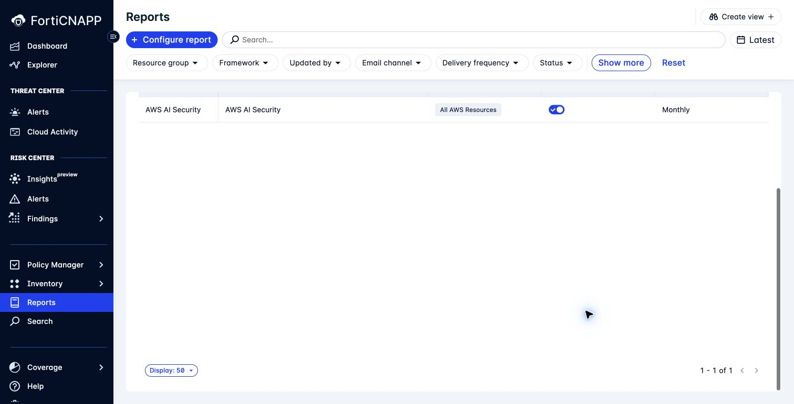
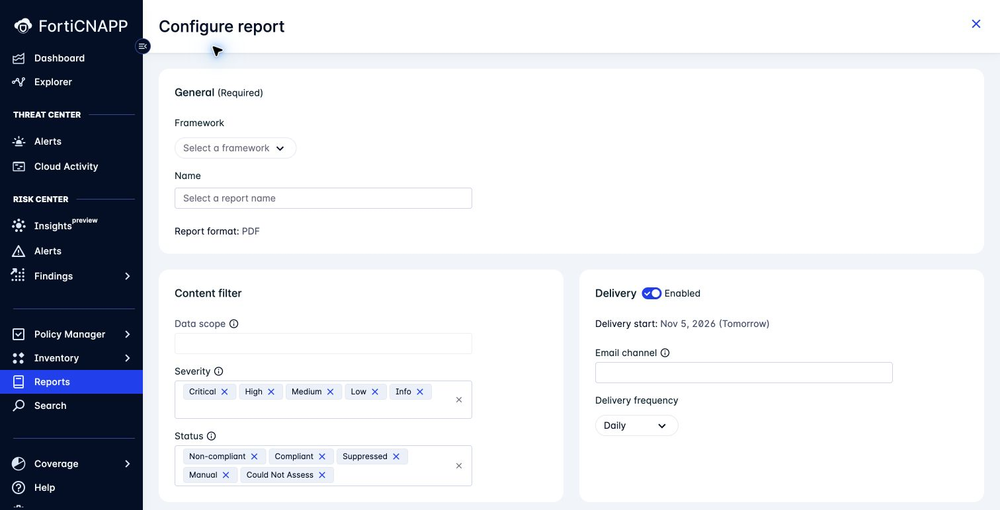

# Lab 11: Build AWS and Azure CIS reports your team can use

**Environment:** FORTINETAPACDEMO. **Access:** Read/write.

## Concepts

A report must give its readers the right evidence for the right resources.
Its configuration selects the framework, scope, assessment statuses, and delivery settings.
The generated report contains the assessment evidence for those selections.
Separate AWS and Azure configurations keep each provider's benchmark and scope clear.

## Objectives

- Create separate AWS and Azure CIS report configurations with the intended scope.
- Check assessment gaps, recipients, and delivery settings before enabling distribution.

## Prerequisites

Complete Labs 7 and 10.
Screenshots show demo report controls. Create reports only in the sandpit.

## Lab steps

### Step 1: Check what an existing report would cover

The AWS and Azure teams need evidence for their own resources. Check how an existing configuration selects that evidence.

1. Confirm **FORTINETAPACDEMO**.
2. Open **Reports**.
3. Inspect an AWS report configuration.
4. Inspect an Azure report configuration.
5. Check which framework and data scope each configuration selects.

**Checkpoint:** Could you tell the AWS owner which resources this report would cover?
Use the selected framework and scope to answer before looking at any compliance score.

### Step 2: Configure the AWS report

Use the AWS resource group assigned for this lab. Use your participant ID in the report name.

1. Return to **Reports**.
2. Click **Configure report**.
3. Select the required AWS CIS framework and version.
4. Set **Name** to `Workshop-YOURID-AWS-CIS`.
5. Select the approved AWS **Data scope**.
6. Review **Severity** for the findings your reader needs.
7. Review **Status** for failures and assessment gaps your reader must see.
8. Turn off **Enabled** under **Delivery**.
9. Select the **Email channel** assigned for this lab.
10. Review **Delivery frequency**.
11. Create the configuration.
12. Open the saved configuration.
13. Confirm that **Report configuration** is **Disabled**.
14. Turn off its switch if the saved configuration is enabled.

**Checkpoint:** The saved configuration has the required AWS framework and scope. Delivery is disabled.

An email channel is required even when delivery is off.
Check the saved configuration's state. Do not rely only on the creation form's switch.

> **What matters:** A report can hide assessment gaps if you exclude **Manual** and **Could Not Assess** results.

### Step 3: Configure the Azure report

Repeat Step 2 with the required Azure CIS framework. Use the assigned Azure resource group.
Use `Workshop-YOURID-Azure-CIS` as the name.
Select the approved Azure subscription scope. Keep delivery disabled.

**Checkpoint:** Each team has a configuration for its own provider, benchmark version, and scope.
Check these against your Lab 7 evidence. Both configurations remain disabled.

### Step 4: Decide who needs the evidence

1. Choose who needs each report and how often it would help them.
2. Compare that plan with the selected email channel.
3. Identify the owner who approves enabling delivery.
4. Check the available report preview from **Cloud Compliance > Frameworks**.

**Checkpoint:** Would the right team receive evidence it can act on?
Check the recipients, scope, frequency, and assessment gaps before recommending delivery.

Do not enable delivery to a shared email channel during the lab.
Keep both configurations for cleanup in Lab 16.

---
Next: [Lab 12: Can you trust the data behind your findings?](../lab-12/README.md).
