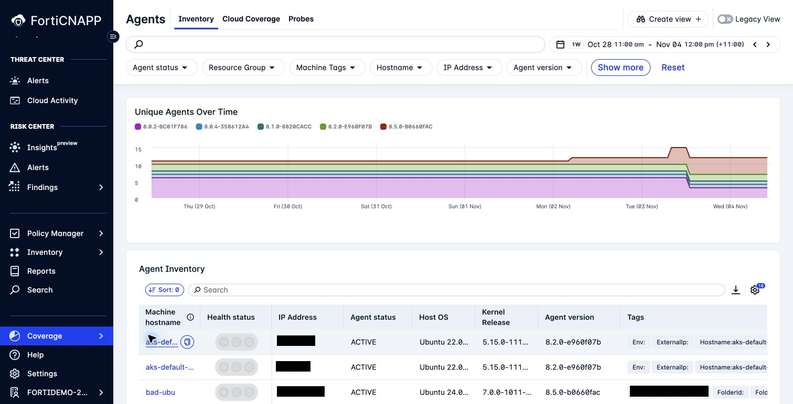

# Lab 12: Check coverage and notification routing

**Environment:** FORTINETAPACDEMO. **Access:** Read-only review.

## Objectives

Check the evidence pipeline before trusting a result.
Distinguish a detection policy, an alert route, and a report delivery configuration.

## Prerequisites

Complete Lab 11. Do not change shared integrations or channels.

## Lab steps

### Step 1: Check collection

1. Open **Settings > Cloud accounts**.
2. Inspect the configuration integration for an AWS or Azure scope.
3. Check its state and last successful collection.
4. Inspect the activity log integration separately.
5. Open **Coverage > Agents**.
6. Check agent status and last check-in.
7. Open **Coverage > Agentless**.
8. Compare that coverage with the agent view.

Check collection state in the sandpit.

**Checkpoint:** Record one collection source and its latest successful update.
An enabled integration and a healthy collection state are different checks.

### Step 2: Review routing

1. Open **Settings > Channels**.
2. Inspect a channel without changing its recipients.
3. Examine the alert-routing controls available to your role.
4. Trace the intended route for a composite alert.
5. Compare that route with the email channel in your report configuration.

**Checkpoint:** Explain which setting defines the condition, which setting routes the alert, and which setting delivers the report.

> **What matters:** Check that alert notifications reach the responsible team.

### Step 3: Record an operational issue

Write a short handover for one failed or stale collection, if present.
Include the affected integration type, time, observed state, and next check.
Keep credentials and unrelated identifiers out of the handover.

**Checkpoint:** Your handover reports the observed issue without claiming an unverified cause.

---
Next: [Lab 13: Use the CLI with explicit tenant scope](../lab-13/README.md).
