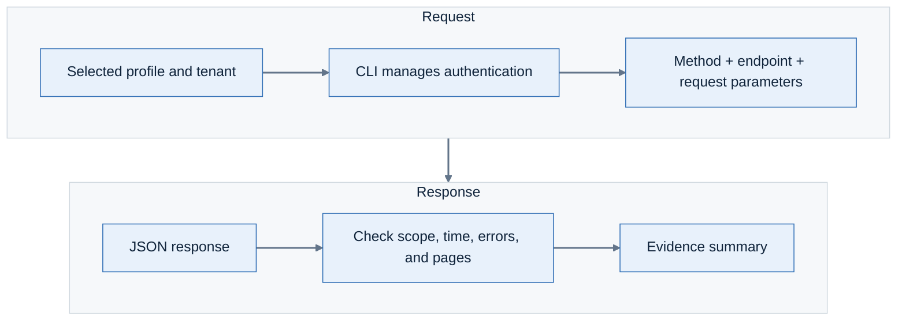

# Lab 14: Get the evidence behind an alert through the API

**Environment:** Both tenants. **Access:** Read-only.

## Concepts

Automation needs access to evidence, not just a view of it.
An API request specifies a method, endpoint, and parameters.
Filters and pagination determine how much data the response contains.
Check the returned values against your console investigation before using them in another workflow.

## Objectives

- Retrieve an alert through the API and match its values to console evidence.
- Determine whether a result is complete, partial, or a failed check.

## Prerequisites

Complete Lab 13. Keep an alert ID from your composite investigation.
Use the [API endpoint documentation](https://api.lacework.net/api/v2/docs) for request fields.

## Lab steps

### Step 1: Follow the request to the evidence

You want a script to retrieve the same evidence you examined in the console.
The diagram shows where scope, authentication, and response checks fit.



The `lacework api` command manages authentication for the selected profile.

### Step 2: Compare a CLI list with an API response

```bash
set -o pipefail
sh tools/lw-read.sh sandpit api get /api/v2/CloudAccounts \
  | jq '{responseFields:keys,returnedRows:(.data | length)}'
```

Compare the shape with `cloud-account list` from Lab 13.
The native list command returns an array. This REST response wraps rows in `data`.

**Checkpoint:** You can locate the returned rows under `data`.
A script must use that response structure to count rows correctly.

### Step 3: Check your incident evidence through the API

Retrieve the alert from Lab 2. You will check whether the API supports the same conclusion as the console.
Set the ID from that investigation:

```bash
ALERT_ID=REPLACE_WITH_ALERT_ID
ALERT_FILE=$(mktemp)
sh tools/lw-read.sh demo api get \
  "/api/v2/Alerts/${ALERT_ID}?scope=Details" > "$ALERT_FILE"
```

Open the response in your private terminal:

```bash
jq '.data' "$ALERT_FILE" | less
```

In `less`, type `/` followed by an entity value from Lab 2. Press Enter to search.
Use `n` for the next match. Press `q` to return to the shell.

1. Choose an entity or activity value that supports your incident explanation.
2. Find the matching value in the API response.
3. Check a second value before relying on the response in an automated investigation.

**Checkpoint:** Does this response support your console explanation?
Point to the matching values. Identify any missing evidence that would limit an automated conclusion.

Alert details can contain identities, addresses, and command lines. Keep the file private.
Remove it after the comparison:

```bash
rm -f "$ALERT_FILE"
```

### Step 4: Search for a period of activity

A search endpoint can use `POST` without changing tenant configuration.
Check the endpoint documentation to determine its effect.

Run this read-only search in the sandpit:

```bash
REQUEST_FILE=$(mktemp)
jq -n '{timeFilter:{
  startTime:(now-86400 | floor | todate),
  endTime:(now | floor | todate)}}' > "$REQUEST_FILE"

lacework api post /api/v2/Alerts/search --file "$REQUEST_FILE" \
  --profile fortinetapacdemo --account partner-demo \
  --subaccount fortinetapacdemo --json --noninteractive \
  | jq 'if . == null then {returnedRows:0,hasMore:false}
    else {returnedRows:(.data | length),
      hasMore:(.paging.urls.nextPage != null)} end'

rm -f "$REQUEST_FILE"
```

Check `timeFilter` before you run the request. It selects the last 24 hours.

**Checkpoint:** The result shows `returnedRows` and `hasMore` for the requested period.
The endpoint documentation confirms that this POST searches alerts; it does not create them.

### Step 5: Could you trust the total?

You want to report how many alerts matched. Check whether the response is the whole result or just one page.

1. Inspect the endpoint's response schema.
2. Check for paging metadata and a next-page link.
3. Retrieve all required pages before calculating a full total.
4. Record the time window and filters with the result.
5. Preserve request failures as failures.

**Checkpoint:** Would you publish this count as a complete total?
Use the time window, filters, and paging state to justify your answer. A failed request cannot establish a count.

> **What matters:** An empty result, a failed request, and a first page are different outcomes.
> Do not turn any of them into an unsupported claim about tenant security.

---
Next: [Lab 15: Repeat your investigation with the FortiCNAPP agent skill](../lab-15/README.md).
