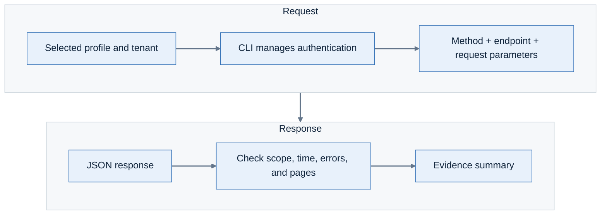

# Lab 14: Retrieve evidence through the API

**Environment:** Both tenants. **Access:** Read-only.

## Objectives

Understand a REST request and its response. Retrieve the alert behind a console investigation.
Check time filters, response shape, and pagination before reporting counts.

## Prerequisites

Complete Lab 13. Keep an alert ID from your composite investigation.
Use the [API endpoint documentation](https://api.lacework.net/api/v2/docs) for request fields.

## Lab steps

### Step 1: Identify the request parts



The `lacework api` command calls the REST API. The CLI manages authentication for the selected profile.

### Step 2: Compare a CLI list with an API response

```bash
set -o pipefail
sh tools/lw-read.sh sandpit api get /api/v2/CloudAccounts \
  | jq '{responseFields:keys,returnedRows:(.data | length)}'
```

Compare the shape with `cloud-account list` from Lab 13.
The native list command returns an array. This REST response wraps rows in `data`.

**Checkpoint:** Explain why the same `jq` expression does not work for every command.

### Step 3: Retrieve one alert

Set the ID from your own investigation:

```bash
ALERT_ID=REPLACE_WITH_ALERT_ID
sh tools/lw-read.sh demo api get \
  "/api/v2/Alerts/${ALERT_ID}?scope=Details" \
  | jq '{responseFields:keys,dataFields:(.data | keys)}'
```

**Checkpoint:** The request succeeds in the expected tenant.
Inspect the required evidence in an approved private workspace. Share only the fields needed for your conclusion.
Alert details can contain hostnames, addresses, identities, and command lines.

### Step 4: Understand search requests

A search endpoint can use `POST` without changing tenant configuration.
Check the endpoint documentation to determine its effect.

Run this read-only search in the sandpit:

```bash
REQUEST_FILE=$(mktemp)
jq -n '{timeFilter:{
  startTime:(now-86400 | floor | todate),
  endTime:(now | floor | todate)}}' > "$REQUEST_FILE"

lacework api post /api/v2/Alerts/search --file "$REQUEST_FILE" \
  --profile fortinetapacdemo --account partner-demo \
  --subaccount fortinetapacdemo --json --noninteractive \
  | jq 'if . == null then {returnedRows:0,hasMore:false}
    else {returnedRows:(.data | length),
      hasMore:(.paging.urls.nextPage != null)} end'

rm -f "$REQUEST_FILE"
```

Check `timeFilter` before you run the request. It selects the last 24 hours.

**Checkpoint:** Explain why a search POST and a policy creation POST have different effects.

### Step 5: Check completeness

1. Inspect the endpoint's response schema.
2. Check for paging metadata and a next-page link.
3. Retrieve all required pages before calculating a full total.
4. Record the time window and filters with the result.
5. Preserve request failures as failures.

**Checkpoint:** State whether your result is complete, a sample, or an incomplete check.

> **What matters:** An empty result, a failed request, and a first page are different outcomes.
> Do not turn any of them into an unsupported claim about tenant security.

---
Next: [Lab 15: Investigate with the FortiCNAPP agent skill](../lab-15/README.md).
